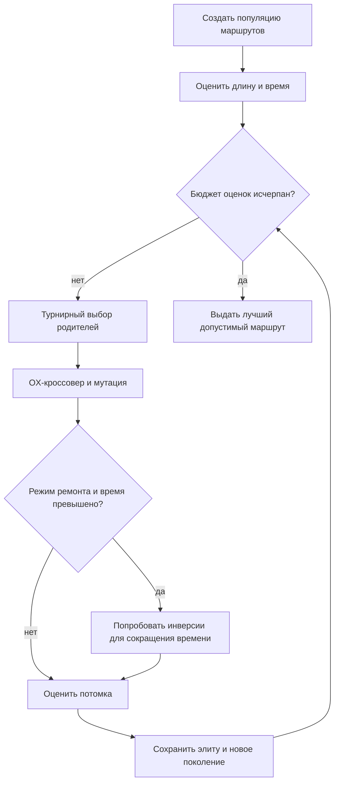
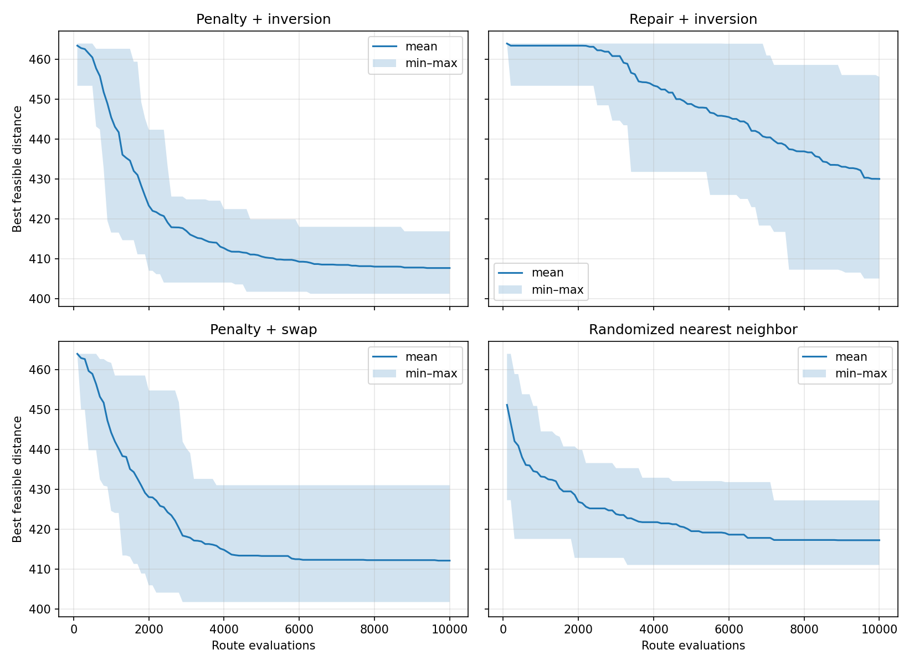
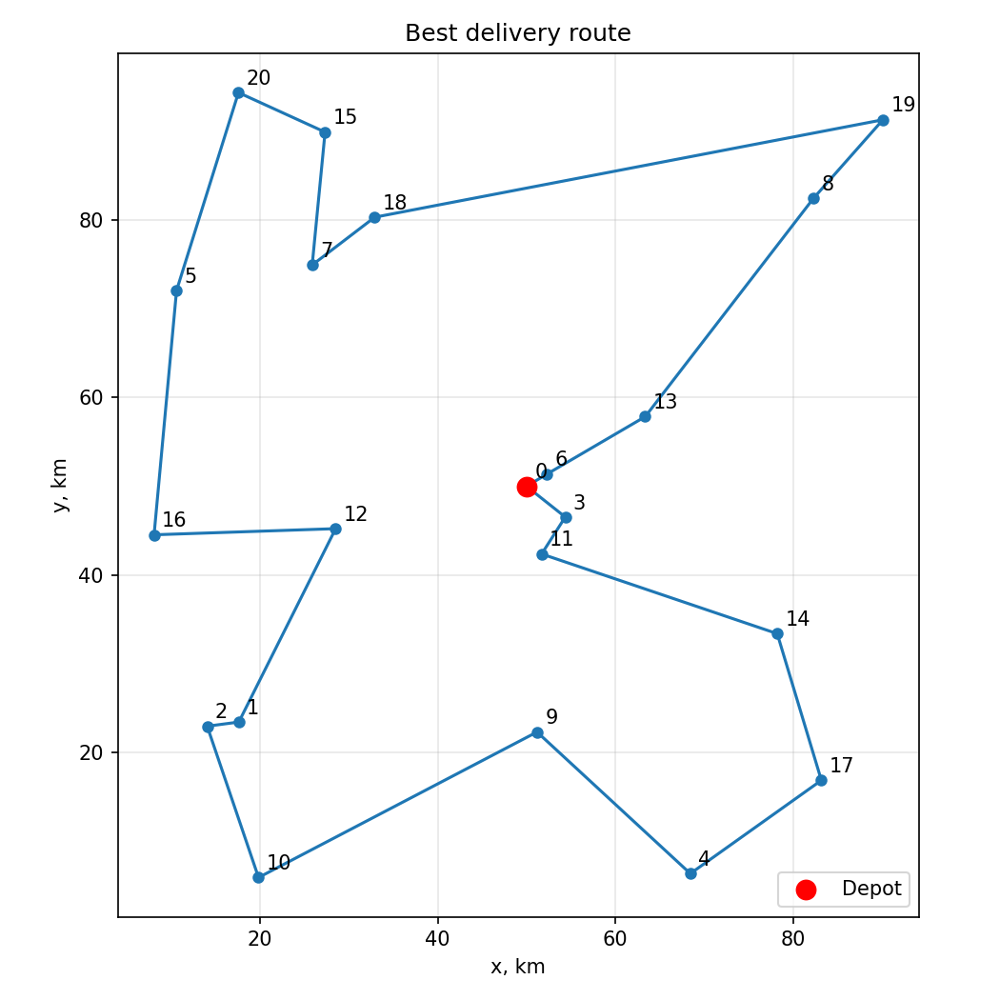

# Лабораторная работа № 2

**Генетический алгоритм для дискретной задачи с ограничением времени**

- Дисциплина: «Эволюционное программирование и генетические алгоритмы».
- Выполнил: **Сухарев Фёдор Дмитриевич**, группа 527, номер в списке 23.
- Вариант 12, язык Python 3.

## 1. Постановка задачи

Для группы 527 индекс \(Q=2\), номер в группе \(N=23\), год выполнения \(Y=26\). Номер варианта:

\[
V=1+((17N+7Q+Y)\bmod20)
 =1+((17\cdot23+7\cdot2+26)\bmod20)=12.
\]

Вариант 12 — маршрут доставки по 15–25 точкам с ограничением времени. В работе используются **20 адресов и одно депо**. Машина выезжает из депо 0, посещает каждый адрес ровно один раз и возвращается в депо. Цель — минимизировать пройденное расстояние при общем времени не больше **535 минут**.

## 2. Данные и математическая модель

Координаты депо \((50,50)\) заданы вручную. Координаты 20 адресов сгенерированы равномерно в квадрате от 5 до 95 км по каждой оси генератором Python с `seed=52723` и округлены до сотых. Генератор приведён в [generate_data.py](generate_data.py), готовый набор — в [points.csv](data/points.csv).

Расстояние между точками — евклидово. В обычном случае машина проходит 1 км за минуту (скорость 60 км/ч). Для поездки между левой и правой половинами карты время ребра увеличивается на 25%: это модель более медленного переезда через загруженный центр. На каждом адресе обслуживание занимает 2 минуты.

Решение \(\pi=(\pi_1,\ldots,\pi_{20})\) — перестановка номеров от 1 до 20. Маршрут целиком: \(0\to\pi_1\to\cdots\to\pi_{20}\to0\). Для последовательных точек маршрута \(a,b\) обозначим расстояние через \(d_{ab}\), а множитель времени через \(m_{ab}\), равный 1,25 при пересечении линии \(x=50\) и 1 иначе. Тогда

\[
L(\pi)=\sum_{(a,b)\text{ в маршруте}}d_{ab},\qquad
T(\pi)=\sum_{(a,b)\text{ в маршруте}}m_{ab}d_{ab}+20\cdot2.
\]

Нужно минимизировать \(L(\pi)\) при \(T(\pi)\le535\). Перестановка сама обеспечивает однократное посещение адресов; ограничение времени проверяется отдельно.

## 3. Примеры допустимости

| Решение | Длина | Время | Причина |
| --- | ---: | ---: | --- |
| Маршрут ближайшего соседа `0–6–3–11–13–14–17–4–9–12–16–2–1–10–5–7–18–15–20–8–19–0` | 464,01 км | 528,52 мин | Допустим: все адреса по одному разу, время меньше 535 |
| Лучший найденный маршрут, приведённый ниже | 401,23 км | 464,64 мин | Допустим |
| `0–1–2–…–20–0` | 1073,50 км | 1309,76 мин | Недопустим по времени |
| `0–1–2–…–19–19–0` | 1003,52 км | 1221,63 мин | Недопустим: адрес 19 повторяется, адрес 20 пропущен; также превышено время |

## 4. Кодирование и генетический алгоритм

Особь — список из 20 целых чисел, например `[6, 13, 8, ...]`. Это порядок посещения адресов; депо в список не входит и добавляется при подсчёте маршрута. Декодирование сводится к добавлению нуля в начало и конец. В начальной популяции 60 особей: один маршрут строится методом ближайшего соседа, остальные 59 — случайные перестановки. Поэтому с самого начала есть хотя бы одно допустимое решение.

Для выбора родителей используется турнир из трёх особей. С вероятностью 0,9 выполняется **OX-кроссовер**: случайный отрезок берётся у первого родителя, а остальные адреса дополняются в порядке второго без повторений. С вероятностью 0,2 потомок мутирует. Сравниваются два оператора мутации: **инверсия** случайного отрезка и **обмен** двух адресов. Оба сохраняют перестановку. Лучшая особь поколения переносится без изменений. ГА останавливается после 10 000 оценок полного маршрута, включая проверки при ремонте.



### Ограничение времени

В **режиме штрафа** приспособленность особи равна

\[
F(\pi)=L(\pi)+25\max(0,T(\pi)-535).
\]

У маршрута, который опоздал на одну минуту, к длине прибавляется 25 условных единиц. В **режиме ремонта** тот же штраф используется для отбора, но для недопустимого потомка дополнительно пробуется до 10 инверсий отрезка. Если инверсия сократила время, она принимается; поиск прекращается при достижении допустимости. Ремонт может не успеть исправить маршрут, поэтому в обоих режимах отдельно хранится лучший *допустимый* маршрут. Недопустимый маршрут не выдаётся как ответ.

## 5. Сравниваемые методы и бюджет

Выполнено по 20 независимых запусков каждого метода с `seed=2026,…,2045`:

| Метод | Работа с ограничением | Мутация |
| --- | --- | --- |
| Штраф + инверсия | только штраф | инверсия отрезка |
| Ремонт + инверсия | штраф и попытка ремонта | инверсия отрезка |
| Штраф + обмен | только штраф | обмен двух адресов |
| Случайный ближайший сосед | строит маршруты, затем проверяет время | не применяется |

В сравнении первого и второго методов меняется способ работы с ограничением. В сравнении первого и третьего — только оператор мутации. Контрольный метод на каждом шаге выбирает случайно один из двух ближайших ещё не посещённых адресов; первый его маршрут строится обычным ближайшим соседом. У каждого метода ровно **10 000 полных оценок маршрута** на запуск. Это учитывает и дополнительные оценки во время ремонта. Построение маршрута и выбор соседей в бюджет оценок не входят, поэтому сравнение по времени выполнения программы отдельно не делается.

## 6. Результаты

Числа ниже — статистика длины лучшего допустимого маршрута в каждом из 20 запусков. Стандартное отклонение выборочное. Меньше — лучше.

| Метод | Лучшее | Среднее | Медиана | Ст. откл. | Худшее |
| --- | ---: | ---: | ---: | ---: | ---: |
| Штраф + инверсия | 401,23 | 407,69 | 403,78 | 6,18 | 416,90 |
| Ремонт + инверсия | 405,05 | 430,05 | 430,75 | 16,49 | 455,66 |
| Штраф + обмен | 401,73 | 412,13 | 409,65 | 7,98 | 431,05 |
| Случайный ближайший сосед | 411,04 | 417,25 | 415,51 | 5,50 | 427,25 |

Полные результаты: [runs.csv](results/runs.csv). Через каждые 100 оценок сохранялось лучшее допустимое расстояние; минимум, среднее и максимум по 20 запускам находятся в [history.csv](results/history.csv).



Лучший результат получен методом «штраф + инверсия» с `seed=2035`:

`0 → 6 → 13 → 8 → 19 → 18 → 7 → 15 → 20 → 5 → 16 → 12 → 1 → 2 → 10 → 9 → 4 → 17 → 14 → 11 → 3 → 0`.

Длина — **401,23 км**, время — **464,64 мин**, запас до лимита — 70,36 мин. Таблица порядка посещения — [best_route.csv](results/best_route.csv).



## 7. Анализ

Штраф с инверсией дал средний маршрут на 9,56 км короче, чем случайный ближайший сосед, и на 4,44 км короче, чем штраф с обменом. Инверсия меняет целый участок маршрута и может убрать пересечение длинных рёбер, тогда как обмен двух адресов чаще даёт более резкое нарушение удачного порядка.

Ремонт при том же числе оценок оказался хуже штрафа без ремонта. На проверку инверсий он тратит бюджет: в среднем получилось около 18 полных поколений вместо 168. Поэтому дополнительных потомков исследуется меньше. Это не означает, что ремонт всегда хуже; здесь он оказался слишком затратным в выбранной реализации.

Лучший результат улучшает исходный маршрут ближайшего соседа (464,01 км) на 62,78 км. Он также лучше лучшего маршрута контрольного метода (411,04 км), но глобальный оптимум для этих данных неизвестен. Поэтому утверждать, что найден именно оптимальный маршрут, нельзя. Для улучшения можно пробовать более дешёвый ремонт или локальный поиск после ГА, однако это потребует нового честного сравнения бюджета.

## 8. Воспроизведение

Из папки `lab2`:

```bash
python -m pip install -r requirements.txt
python -m unittest discover -s . -p "test_*.py"
python main.py
```

Параметры и seed приведены в [config.json](config.json). Входные данные входят в работу; повторно получить их можно командой `python generate_data.py`. Ключевые операторы реализованы самостоятельно, `matplotlib` используется только для графиков.
